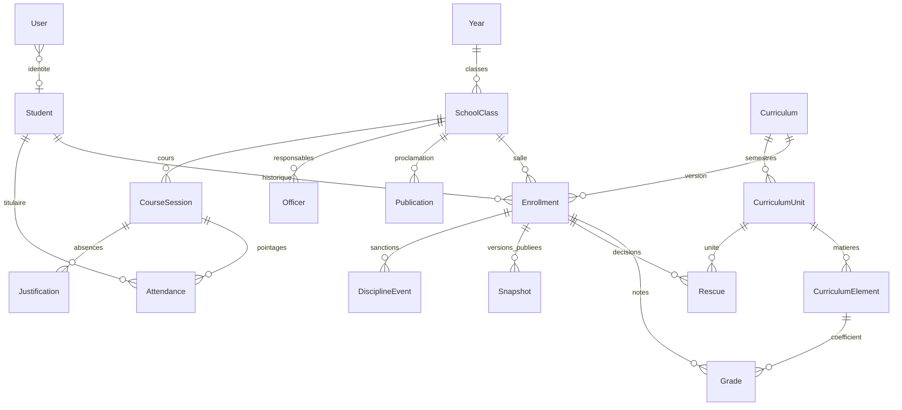
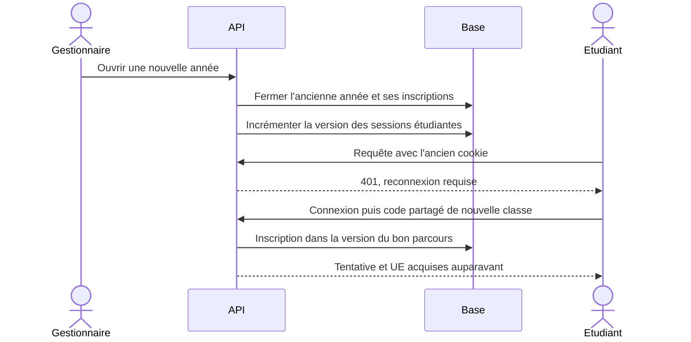
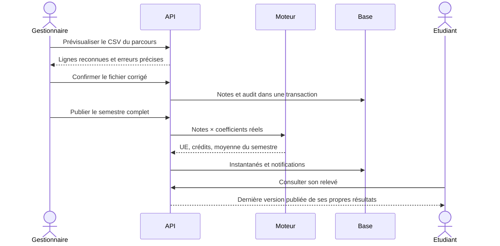

# Modèle du SI implémenté

Les modules `AcademicApi`, `IdentityApi`, `GradesApi`, `ProgressApi`, `AttendanceApi`, `AttendanceImportApi`, `DocumentsApi` et `ExportsApi` partagent une base relationnelle et des transactions. Le contrôle central `Access` recharge les permissions en base à chaque requête. Les programmes sont des versions immuables : une copie JSON conserve leur structure et des tables UE/EC garantissent les clés étrangères SQL.

Les affectations de rôles et les listes de permissions sont des tableaux JSON d'identifiants/capacités contrôlés par les endpoints. Le code métier ne donne pas un droit en fonction d'un nom comme « DAAS ». Les fonctions de délégué, adjoint et secrétaire sont des mandats contextuels et ne permettent pas d'agir dans une autre classe.

`grades.view`, `grades.import`, `grades.update`, `grades.publish` et `grades.rescue` sont indépendantes. Une permission de groupe comme `grades.manage` regroupe les opérations de son module. Les droits étudiants séparent consultation, création, modification, désactivation, suppression de fiches vides, transfert et réinitialisation d'identifiants.

Une rectification publiée ajoute une version du relevé dans la même transaction que la note et l'audit. Une décision de repêchage conserve la valeur de la note. Le PDF reprend les notes, noms de matières et identité figés à la publication. Les transferts conservent les anciens dossiers, notes, décisions et relevés.
